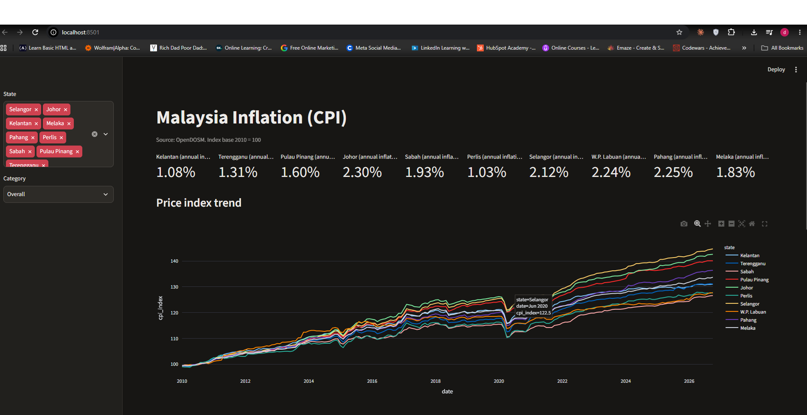

# Malaysia Inflation (CPI) Dashboard

Interactive dashboard that tracks Malaysia's consumer price index by state and category, built from OpenDOSM open data.

## Features
- Filter by state and category
- Price index trend and year-on-year inflation (%)
- Latest-month comparison across all states

## Tech stack
Python, pandas, DuckDB, Streamlit, Plotly

## Data
OpenDOSM CPI by state: https://open.dosm.gov.my/data-catalogue/cpi_state

## How to run
    pip install -r requirements.txt
    python etl.py
    streamlit run app.py

## Project structure
- `etl.py` downloads, cleans and loads the data into DuckDB
- `queries.sql` defines the year-on-year inflation view
- `app.py` is the Streamlit dashboard

## What I learned
1. (write one thing about ETL / DuckDB)
2. (write one thing about SQL window functions, e.g. LAG for YoY)
3. (write one thing about Streamlit or Git)